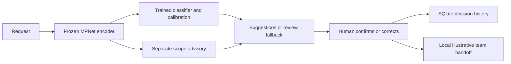

# IntentDesk

**Local NLP intent review and large-data customer-feedback ML experiments.**

IntentDesk helps a reviewer identify what a request is about and prepare the appropriate team handoff. It includes reproducible model comparisons, evaluation reports, a Python API, a browser interface and a card-support demonstration. It runs on CPU without paid model APIs.

> Student portfolio project, developed with AI coding assistance. The card workflow uses frozen pretrained MPNet features. The separate feedback lab trains word transformers from random initialization and compares classical supervised/unsupervised methods. Outputs require interpretation and human review. Customer savings and production reliability have not been established.


## What it does

“I lost my credit card” → suggests **Lost card** → a reviewer confirms or corrects it → prepares an illustrative **Card security** handoff locally.

- **Research demo:** 150 English intent categories, scope advisory, review queue and versioned decision history.
- **Card-support pilot:** six categories plus outside-desk and clarification choices; 14 fictional tickets per reviewer, balanced between manual and assisted review.
- **Separate retrieval experiment:** disk-based BM25 search over 8.84 million MS MARCO passages. These research passages are not customer support documentation or verified answers.
- **Updated card workflow:** a separately trained semantic/character hybrid at `/card-v3`, with its own review queue and a learned clarification category. The original queue and pilot remain preserved.
- **Large-data feedback ML lab:** pinned 1.98 GB of public reviews, product-disjoint fit/development/test partitions, classical rating classifiers, numeric regression, clustering, full-fit streaming learning and custom transformers trained from scratch. Review stars are a separate target from support intents. See [the lab guide](docs/FEEDBACK_ML_LAB.md).

The feedback lab completed **20 epochs for each scratch transformer** and both final evaluations. The original preselected streaming classifier scored **70.37% accuracy / 0.5427 macro-F1** on its original check. On a separate fresh product-group sample, the development-selected word/character model scored **69.13% / 0.5591**, versus the original model on that same sample at **67.955% / 0.5487**. The app uses the verified improvement and displays both comparisons separately. **90% accuracy was not achieved.** See [the completed follow-up](reports/Milestone_11.md).

No account is accessed, no external ticket is sent, and no conversational answer is generated. Review feedback does not automatically retrain a model.

## Measured results

| Experiment | Recorded outcome | Interpretation |
| --- | --- | --- |
| Preselected MPNet + calibrated linear classifier | **96.24% accuracy, 0.9624 macro-F1**, 4,500 known-intent final requests | Crowdsourced benchmark performance; frozen encoder |
| Larger neural head | **94.27%** known-intent final accuracy | Bigger did not win; comparison was fixed before final exposure |
| Original unsupported-request thresholds | Would accept **135/1,000** unsupported final requests | Failed policy remains disabled; all requests require review |
| Separate scope advisory | **97/100** fresh OOS examples flagged; **78/1,496** known examples incorrectly flagged | Known examples reuse calibration data; not an independent joint evaluation |
| Full-corpus retrieval | **MRR@10 0.2195**, mean recall@10 **0.435** | Fixed 100-query official development sample, not leaderboard test |
| Manual versus assisted pilot | **0 completed human comparisons** at publication | Automated verification excluded; no measured human improvement |
| Synthetic robustness suite | **38/60 (63.3%)** provisional label agreement; **0/12** clarification cases matched | Assistant-authored development cases, zero human-reviewed labels; not independent accuracy |
| Updated hybrid card workflow | **54/60** on exposed development cases; **29/32** on a reserved synthetic check, versus original **21/32** | Zero human-reviewed labels; some negation/multiple-issue/outside errors remain; check now consumed |
| Feedback lab: streaming_sgd (preselected) | **70.37% accuracy, 0.5427 macro-F1**, 20,000 product-disjoint review-rating test examples | Separate subjective-rating task; 100,000 balanced fit examples for controlled candidates, 2,912,393 for streaming; final test now consumed |
| Feedback improvement: word/character SGD (preselected) | **69.13% accuracy, 0.5591 macro-F1**, versus original **67.955% / 0.5487** on the same fresh 20,000-review check | Excludes all previously tested products; a different population from the original check; no test reselection |

[Final classifier report](reports/Milestone_05.md) · [Scope limitations](reports/Milestone_06.md) · [Workflow protocol](docs/CARD_SUPPORT_PILOT.md) · [Machine-readable evidence](reports/release_evidence.json)

[Robustness findings](reports/Milestone_08.md) expose typos, negation and ambiguity weaknesses in the current card workflow. The [recorded run](reports/robustness_v1/report.md) preserves its disagreements and confusion matrix. Its task and references differ from the known-intent benchmark above, so the two percentages are not directly comparable.

[The workflow update](docs/CARD_WORKFLOW_UPDATE.md) records the lexical candidate's weak reserved result, the later hybrid comparison and the remaining errors. These improvements are synthetic evidence, not proof of reliability on real customer traffic.


[The large-data lab report](reports/Milestone_10.md) preserves every final candidate, numeric regression, clustering diagnostics and actual learning curves. It uses **4,629,544 source reviews / 1.98 GB** and trains custom scratch transformers with **1,318,021** and **2,966,533** trainable parameters. Dataset size and model size do not guarantee better results or business benefit.

## What the repository demonstrates

Python, NumPy, scikit-learn, PyTorch, NLP, TF-IDF, transfer learning, logistic/linear regression, SVM, decision trees, random forests, KNN, SVD, MiniBatchKMeans, streaming learning, neural training, custom multi-head attention, ReLU/GELU, dropout, cross-entropy, AdamW, calibration, data leakage checks, macro-F1, error analysis, out-of-scope detection, FastAPI, SQLite, BM25 and automated testing.

The project compares a majority baseline, word/character TF-IDF logistic regression, a linear classifier on frozen MPNet embeddings, and small/large PyTorch heads. The encoder has approximately **109 million frozen parameters**. The trained heads have **117,782** and **1,389,206** parameters. It does not demonstrate training a foundation model, reinforcement learning, computer vision or production deployment.



## Run locally

Requirements: Python **3.12**, [uv](https://docs.astral.sh/uv/), and internet access for the first dataset/model downloads. This project was built on an 8 GB RAM laptop using CPU execution and two compute threads. Exact timings depend on hardware.

```bash
git clone https://github.com/Joepikka/intentdesk.git
cd intentdesk
uv sync --locked --extra dev --extra neural --extra web

# Acquire audited data and train the local models.
uv run --locked intentdesk prepare
uv run --locked intentdesk train
uv run --locked --extra neural intentdesk embed
uv run --locked --extra neural intentdesk train-neural
uv run --locked --extra neural intentdesk build-policy

uv run --locked --extra neural --extra web intentdesk serve
```

Open **http://127.0.0.1:8765** or **http://127.0.0.1:8765/pilot**. Keep the server terminal running. Trained weights, dataset files, indexes and local review databases are deliberately excluded from GitHub, so a fresh clone needs preparation/training. The pilot can still be used with explicit manual review when the optional scope advisory is unavailable.

For the separately trained scope advisory, optional retrieval index and experiment-preservation rules, read [reproduction instructions](docs/REPRODUCING.md). Retrieval needs roughly 3.06 GB of uncompressed corpus plus a 4.70 GB index and additional build/cache space. It is optional for the card pilot.

The published final and scope reports are historical consumed evaluations. A fresh checkout is a new experiment, not the original weights. Never tune against the published final results or delete frozen experiment markers to reselect a model. Preserve the evidence before generating new reports.

For the updated card desk, follow [the V3 guide](docs/CARD_WORKFLOW_UPDATE.md). After the original embedding/policy/scope setup, train the separate candidates with `intentdesk train-card-v2` and `intentdesk train-card-v3`. Open `/card-v3` on the running server. The current development instance is served at **http://127.0.0.1:8788/card-v3**. Model weights and local review records remain excluded from GitHub.

The feedback lab can run independently of the original intent artifacts:

```bash
uv run --locked intentdesk prepare-feedback
uv run --locked --extra neural intentdesk train-feedback
uv run --locked --extra neural intentdesk evaluate-feedback
uv run --locked --extra neural --extra web intentdesk serve-feedback --port 8790
```

Open **http://127.0.0.1:8790/ml-lab**. Preparation downloads two complete pinned review subsets; training/checkpointing takes time on CPU. The lab's original product-disjoint test becomes consumed after evaluation. Preserve it and use fresh data for any later model selection. See [protocol, limitations and commands](docs/FEEDBACK_ML_LAB.md).

## Verify

```bash
uv run --locked --extra dev --extra neural --extra web pytest -q
node --test tests/queue_page.test.mjs
uv run --locked python learning/math_exercise.py

# With the app running; exports actual recorded human results only.
uv run --locked intentdesk pilot-report

# Without the server; first export a blank sheet for a person to label.
uv run --locked intentdesk robustness-template
uv run --locked --extra neural intentdesk test-robustness
# After actual review: append --labels local/robustness_labels.csv
```

Current local checks (14 October 2026): **162 Python tests and 2 JavaScript tests passed**. Tests use synthetic fixtures and do not require model weights or the large corpus. CI runs the same tests. See [verification scope](docs/VERIFICATION.md).

## Explore the project

| Start with | Purpose |
| --- | --- |
| [Five-minute demonstration](docs/DEMO.md) | Walkthrough with examples, screenshots and honest narration |
| [Learning and interview preparation](docs/INTERVIEW_PREP.md) | Equations, code tracing, exercises and questions to answer yourself |
| [Research and learning map](learning/Research_and_Learning.md) | Papers, concepts and implementation connections |
| [Portfolio evidence](docs/PORTFOLIO.md) | Skills, supported resume wording and limitations |
| [Card-support pilot guide](docs/CARD_SUPPORT_PILOT.md) | Categories, human comparison, timing and data limitations |
| [Local robustness testing](docs/ROBUSTNESS.md) | Synthetic stress cases, blank label sheet, error analysis and graphs |
| [Updated hybrid workflow](docs/CARD_WORKFLOW_UPDATE.md) | Trained candidates, preserved comparisons, new review desk and remaining errors |
| [Large-data feedback ML lab](docs/FEEDBACK_ML_LAB.md) | Supervised classification/regression, clustering and scratch transformers |
| [Completed feedback improvement](docs/FEEDBACK_V2.md) | Fresh product groups, class-weight tradeoffs and verified app integration |
| [ML lab exercises](learning/ML_Lab_Exercises.md) | Attention mathematics, model tradeoffs, leakage and your own demonstrations |
| [Implementation handoff](docs/HANDOFF.md) | Current architecture, frozen experiments and next work |
| [Third-party terms](THIRD_PARTY.md) | Dataset, model and dependency attribution |

Core code is under `src/intentdesk/`, tests under `tests/`, and recorded aggregate reports/figures under `reports/`. Historical milestone counts and test-exposure statements describe those stages; Milestones 5–11 establish the later state.

## Limitations and next work

This is a local English research application, not a banking service. The pilot tickets/reference labels are assistant-authored fiction without independent adjudication. The scope check is small and partly uses reused data. Public pretrained-model exposure to benchmark examples cannot be ruled out. Search can time out under its two-second app budget.

Next: independently review the robustness labels and investigate the recorded failures, complete real human comparison sessions, then seek permissioned representative data and a new untouched joint evaluation. Later model changes require a separate protocol and fresh evaluation. Laya and MiroFish are not integrated here.

## Authorship and licensing

AI assistance was used for implementation, debugging, documentation and experiment scaffolding. Repository ownership does not mean every line was written unaided or every concept mastered. The author should demonstrate understanding by explaining, running, debugging and extending the work; [the learning checklist](docs/INTERVIEW_PREP.md) is intentionally uncompleted.

Original project code and documentation are available under the [MIT license](LICENSE). Third-party datasets, weights and dependencies retain their own terms. CLINC150 attribution is preserved; MS MARCO is restricted to non-commercial research. No raw corpus, model weights, credentials or user-review records are included.
