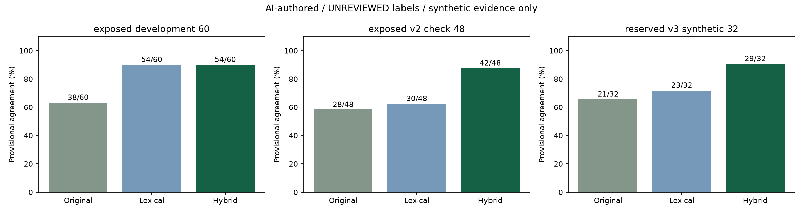
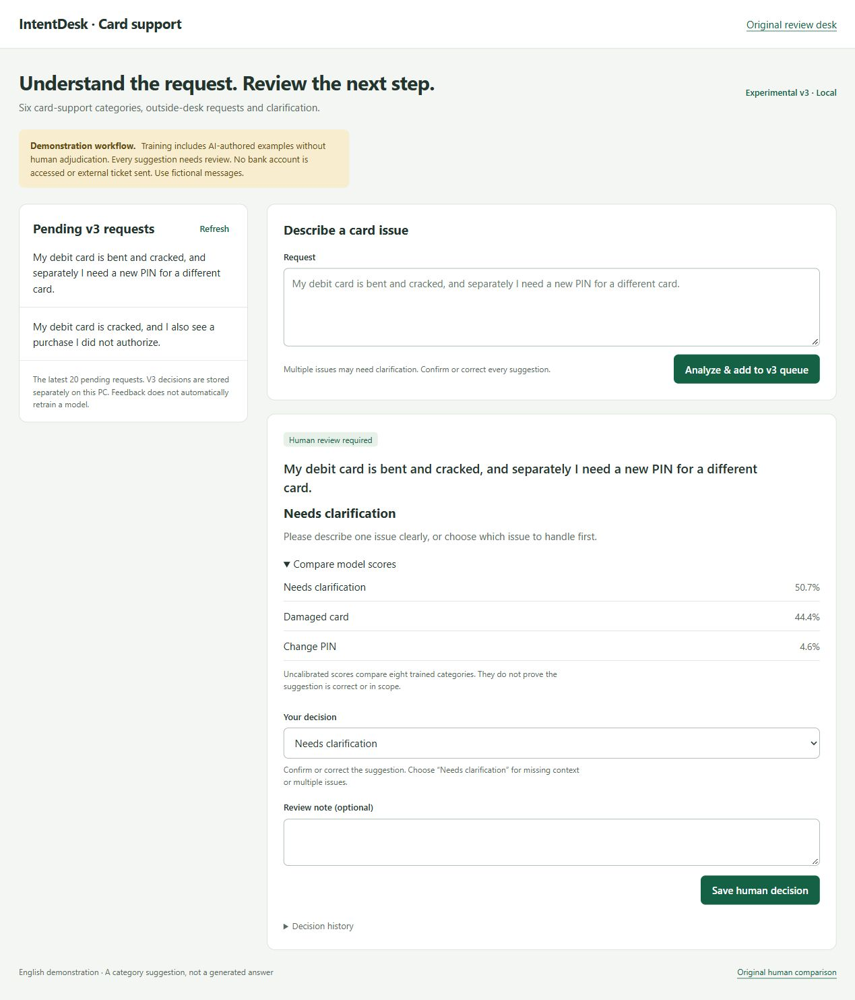

# Card-support model update

The separate hybrid workflow is available at **`/card-v3`**. The original research queue and `/pilot` comparison retain their original model and bindings. V3 has its own local review database; old decisions are not relabeled or used for training.

## What changed

The original workflow maps a single 150-class prediction onto six card categories. Its scope detector does not learn a separate missing-context or multiple-issue class. The new candidates learn eight workflow categories directly, including `oos` and `uncertain`.

Lexical V2 combines word n-grams, character n-grams and a bounded negation token heuristic. Character fragments tolerate some misspellings. Negation tokens retain cues such as “did not authorize”; they do not remove clauses, rewrite the displayed request or decide the category themselves. The heuristic is limited to five tokens and punctuation/contrast boundaries and can misunderstand complex grammar.

Hybrid V3 combines these sparse lexical features with normalized embeddings from the existing frozen MPNet encoder. A class-balanced multinomial logistic regression learns the eight categories. Declared synthetic training examples cover contrasting negation, typos, multiple issues, vague statements and non-banking uses of “card” and “PIN.” These are AI-authored development data, not real customer messages or independently reviewed labels.

Both candidates trained on **14,137 deduplicated rows**: 11,917 original audited fit examples, 909 typo derivatives of supported fit examples and 1,311 synthetic variants. Many variants share a source family; these are not 14,137 independently collected support messages. Original tune/calibration/validation/final splits were not read for model fitting. Exact training/check fingerprint overlap was rejected; semantic near-duplicate/template overlap cannot be ruled out.

V3 reused the original fit embedding cache and encoded 2,220 added texts. Its CPU feature generation/fitting took about **264 seconds**, excluding initial encoder loading and preparatory validation. The encoder's approximately 109 million parameters stayed frozen. No paid API or new dependency was added.

## Actual comparisons

All percentages below mean agreement with **AI-authored, human-unreviewed synthetic references**. They are not independent test accuracy, customer benefit or production approval.

| Same requests and workflow references | Original | Lexical V2 | Hybrid V3 |
| --- | ---: | ---: | ---: |
| Exposed 60-case development suite | 38/60 (63.3%) | 54/60 (90.0%) | 54/60 (90.0%) |
| V2 48-case check, now development data for V3 | 28/48 (58.3%) | 30/48 (62.5%) | 42/48 (87.5%) |
| V3 32-case check, reserved before V3 training and now consumed | 21/32 (65.6%) | 23/32 (71.9%) | 29/32 (90.6%) |

V2's reserved result was weak, with more outside-to-supported errors than the original. It was retained rather than reported as a complete fix. V3 was designed after inspecting that check, so the 48 cases are development evidence for V3. The 32 cases were reserved before V3 training. They still share the same author and policy as the training augmentation and contain only four outside and four clarification cases. That limits independence and generalization.

On the reserved V3 check, typo agreement changed **5/6 → 6/6**, negation **3/6 → 4/6**, and clarification **0/4 → 4/4** from original to hybrid. One outside request was wrongly called replacement-card delivery; one negated declined-card request was called PIN change; one fraud request was marked uncertain. On the exposed 60 cases V3 still gives specific categories to four clarification requests. A later live smoke example combining a cracked card and unauthorized purchase was also incorrectly suggested as fraud. Human review remains necessary.

[Actual aggregate JSON](../reports/card_workflow_v3/summary.json) · [Preserved first V2 check](../reports/card_workflow_v3/lexical_v2_first_check.json) · [Milestone 9](../reports/Milestone_09.md)



## Run on this PC

With the existing artifacts:

```powershell
uv run --locked --extra neural --extra web intentdesk serve --port 8788
```

Open **http://127.0.0.1:8788/card-v3**. Submit a fictional request, inspect the suggestion, then confirm or correct it before saving. Clarification is a fixed request to describe one issue or choose which issue to handle first; it is not a generated conversation. Saving prepares an illustrative local handoff and versioned decision history. No external ticket is sent. Feedback does not automatically retrain a model.



Demonstration inputs: `my debti card was declned when paying for lunch`, `My bank card is causing trouble. I do not have any other information.`, or `My debit card is bent and cracked, and separately I need a new PIN for a different card.` The latter two received clarification in the recorded model/check; variants can still fail. These examples are exposed demonstrations, not new independent evaluation.

For a fresh clone, first complete the original preparation/embedding/policy/scope steps in the README and [reproduction guide](REPRODUCING.md). Then:

```powershell
uv run --locked intentdesk train-card-v2
uv run --locked --extra neural intentdesk train-card-v3
uv run --locked --extra neural intentdesk card-v3 "My bank card is cracked."
uv run --locked --extra neural intentdesk evaluate-card-v3
```

The V3 cache checkpoints eight added texts per batch under ignored `local/card_v3_cache/`. Restarted training creates a separate artifact directory and can reuse validated feature batches. Comparison markers are written before predictions and refuse interrupted or changed evaluations. Completed unchanged evaluations return saved reports. Preserve consumed markers and results. Checking a newly trained copy against these now-public cases is reproduction/development evidence, not a fresh independent test.

## Evaluation and learning boundaries

Model/source/data hashes, dependency lock and reserved check are recorded before training/checking. Dynamic exports stay in ignored `reports/card_v2_runs/` and `reports/card_v3_runs/`. Public aggregates retain actual results. Original consumed classifier/scope checks and the human pilot stay separate. The `check_exposed: false` value in embedded training metadata describes training completion; the separate comparison marker and report record subsequent consumption.

Eight-class scores are **uncalibrated**. A fixed 0.40 maximum-score / 0.10 margin rule asks for clarification for weak supported predictions; these are unvalidated operating assumptions specified before checking. No human label sheet was completed by the AI; see [the consistency review](AI_LABEL_REVIEW.md).

The feature design follows [scikit-learn text-feature documentation](https://scikit-learn.org/stable/modules/feature_extraction.html#text-feature-extraction) and [FeatureUnion documentation](https://scikit-learn.org/stable/modules/compose.html#featureunion-composite-feature-spaces). Explain the learned model yourself:

\[
x=[0.5\,x_{lexical};3\,x_{MPNet}],\quad z=Wx+b,\quad p_k=\frac{e^{z_k}}{\sum_j e^{z_j}}.
\]

Class-balanced fitting weights each class by \(n/(K n_k)\) in regularized cross-entropy. The comparison changes features and their weights, so it does not prove one component alone caused every gain. Future improvement needs independently reviewed representative data and a new untouched joint check, rather than further tuning against these exposed examples.
