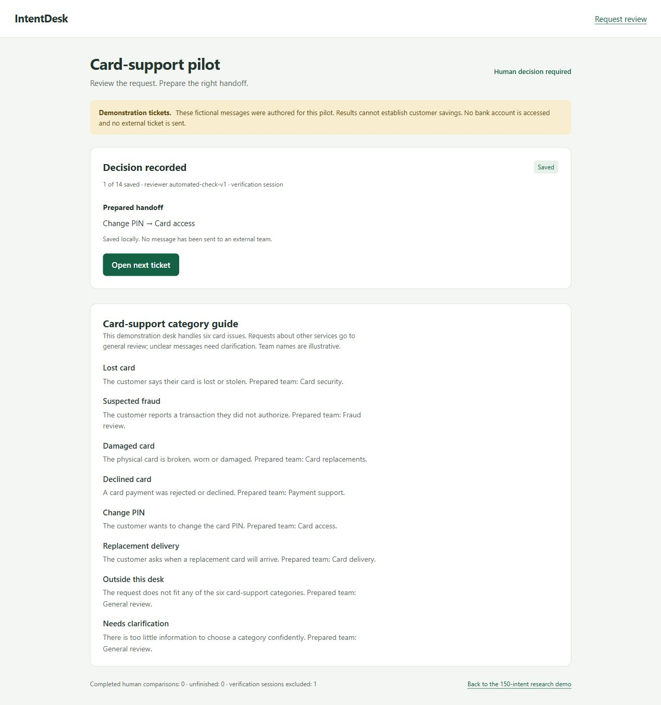

# A five-minute IntentDesk demonstration

This is a recording script and screenshot walkthrough. A personal narrated video has not been recorded. Use fictional requests and explain the code in your own words. Do not describe prepared handoffs as actions performed in a bank system.

## 0:00–0:40 — The problem

“Support staff need to identify what a request is about and which team should handle it. IntentDesk proposes categories and keeps a person responsible for the decision. I am testing whether suggestions help review; customer savings are not yet measured.”

Open `/pilot`, show the six-category guide and explain outside-desk and clarification handling. Tickets are assistant-authored demonstrations.

## 0:40–1:40 — The workflow

Show an assisted ticket, explain the suggestion, explicitly select or correct its category, and save. Explain that the local handoff is an illustrative team mapping. Show a manual ticket without suggestions.

These screenshots came from an automated verification session; they demonstrate interface behavior, not human speed or accuracy. Their numerical results must not be used as human performance evidence.

Complete your actual 14-ticket human session separately, without a script, oracle labels or automated clicks. Read the guide first and mark interruptions. Then export with `intentdesk pilot-report`. If no real person has finished, say so rather than showing fabricated comparisons.

## 1:40–2:30 — The model

Show `train.py` and `neural.py`. Explain TF-IDF logistic regression, a pretrained frozen encoder, and small/large downstream neural heads. Explain which weights trained locally and why frozen features fit limited hardware.

“The larger head did not win. The primary model was selected before the final comparison.”

## 2:30–3:30 — Results and a meaningful failure

Show [Milestone 5](../reports/Milestone_05.md) and its figure. Explain 96.24% known-intent accuracy on 4,500 final examples and the original thresholds' 135/1,000 unsupported false acceptances. Known-label confidence is not a probability that a request belongs in scope.

Show [Milestone 6](../reports/Milestone_06.md): the separate advisory flagged 97/100 fresh OOS examples but incorrectly flagged 78/1,496 reused known examples. That check does not authorize automatic routing.

## 3:30–4:20 — Engineering

Trace request validation → reusable model → suggestions → explicit human save → SQLite version/history. Mention stale-save conflicts, separate review data and tests. Optional: search `photosynthesis chlorophyll` and explain why research-corpus retrieval is separate from support knowledge or generated answers.

## 4:20–5:00 — Ownership and next step

State where AI assisted the work. Name one change you personally made and can explain, once you actually have done so. Explain that current benchmark results cannot be retuned into another independent test.

“Next I need genuine human comparisons and independently reviewed representative data. I would compare any new model on fresh held-out examples and measure both errors and hardware cost.”

Do not claim commercial deployment, real customer savings, autonomous financial actions, a trained foundation model or mastery of every AI topic.
