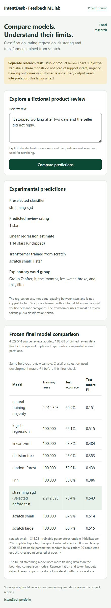

# Large-data feedback ML lab

This expands the portfolio with a separate customer-feedback research task: predict an observed 1–5-star review rating, estimate its numeric value, and explore unlabeled word groups. Reviews are not card-support intents, urgency labels or permissioned support tickets. The original card workflow and consumed evaluations remain preserved.

## Problem and expected behavior

A feedback analyst may have many product reviews to inspect. This lab explores whether text models can estimate the review rating and group similar vocabulary before a person investigates. It also provides a concrete way to compare model quality, training cost and information loss. It does not establish that an analyst saves time; that would require a separate study with people and representative business data.

Enter a fictional review such as **“It stopped working after two days and the seller did not reply.”** The page returns a predicted rating from the classifier selected on development data, a numeric regression estimate, a scratch-transformer prediction, and an exploratory word group with its common features. These outputs may disagree. A cluster ID is not a confirmed topic, and a review-rating model cannot answer a general question or perform a support action.

Use the frozen comparison table to examine all candidates, then the report's confusion matrix to see which ratings are confused. Do not keep trying models against the consumed final test to choose a new winner. The learning exercises describe how to make a new-version experiment.

## Data and splits

Source: [McAuley Lab Amazon Reviews 2023](https://amazon-reviews-2023.github.io/) and its [pinned repository](https://huggingface.co/datasets/McAuley-Lab/Amazon-Reviews-2023/tree/2b6d039ed471f2ba5fd2acb718bf33b0a7e5598e/raw/review_categories). Complete Appliances and Amazon Fashion JSONL files total **1,980,776,143 bytes (1.98 decimal GB)**. SHA256 digests and sizes are pinned. This is a two-category subset, not the entire Amazon collection.

Preparation streams sources into a disk-backed audit. Derived records retain text, rating and product group; user IDs, images and helpful votes are not model inputs. Explicit declarations such as “five stars,” “1-star,” “4/5” and “2 out of 5” are removed before fingerprinting/modeling. Reviews outside 20–8,000 cleaned characters are excluded. The cleanup heuristic cannot remove every shortcut.

A seeded hash assigns parent products approximately **70% fit, 15% development, 15% test**. Each product remains in one partition. Normalized exact-text groups with conflicting ratings or cross-partition appearances are excluded. This protects product groups and exact fingerprints, not every paraphrase, shared user or temporal pattern.

The controlled comparison uses **100,000 fit reviews** balanced at 20,000 per rating, **10,000 development** and **20,000 final test** reviews. Development/test follow deterministic hash order without rating balancing. A separate streaming classifier trains one pass over **every eligible fit review**. Its greater training allocation is disclosed. Actual counts and exclusions are recorded in the prepared manifest and final report.

## Methods

| Method | Implementation and purpose |
| --- | --- |
| Logistic regression | Five-class rating prediction on word/bigram TF-IDF |
| Linear SVM | Margin-based classifier on the same sparse features |
| Decision tree | Classifier on training-fitted reduced features |
| Random forest | 96 bounded-depth trees, two CPU workers |
| KNN classifier | Seven distance-weighted neighbors on normalized reduced features; batched inference |
| Linear regression | Numeric rating estimate with MAE/RMSE/R²; assumes roughly equal spacing between ordinal stars |
| Streaming SGD classifier | Hashed text, log loss, inverse class-frequency weights, full eligible fit partition and resumable checkpoints |
| Truncated SVD | Training-only reduction to at most 64 components |
| MiniBatchKMeans | 20 exploratory groups, no target labels supplied to fitting; rating-balanced sample selection disclosed |
| Small scratch transformer | Random word/position embeddings, one custom attention block, 64 hidden dimensions |
| Larger scratch transformer | Random word/position embeddings, three custom attention blocks, 128 hidden dimensions |

The transformer vocabulary is fitted only on fit text and capped at 20,000 entries including PAD/UNK/CLS. Models use CLS plus the first 63 regex tokens; truncation is measured. Classical models use the full cleaned review. Representations, token budgets and some training allocations differ, so this is not an isolated algorithm-only comparison.

The scratch tokenizer recognizes ASCII words and numbers. There is no independently verified language filter; non-English text can lose information. The two source categories do not establish cross-domain or multilingual generalization.

Both transformers train their embeddings, attention projections, feedforward layers, normalization, position embeddings and classifier from random initialization. No pretrained tokenizer, MPNet embedding or neural weights are loaded. This is compact supervised transformer-classifier training, not foundation-model or generative-language-model pretraining.

## Selection and checking

Training is CPU-only with two compute threads, sparse features and bounded dense reductions/batches. At the user's request, scratch models now train for **20–30 total epochs**, using AdamW, clipping, dropout and batches of 64. Stopping is permitted after epoch 20 with five consecutive epochs without development improvement; epoch 30 is the hard limit. Highest development macro-F1 selects each checkpoint, with accuracy then lowest cross-entropy breaking ties; development macro-F1 selects the classifier across fixed candidates. Test data never selects epochs, hyperparameters or the deployed classifier. The best checkpoint may still be from an earlier epoch.

Source/data/config/lock hashes are bound before training. Vocabulary, features, streaming state and neural checkpoints are checksummed. Completed training can be reused with matching identities. Final markers are written before predictions; completed unchanged checks return saved reports, while interrupted/changed checks refuse re-exposure. Preserve consumed markers and results.

Classification reports include accuracy, macro-F1, per-rating metrics and confusion matrices, with a natural-training majority baseline. Regression has a fit-mean baseline and no prediction clipping. Silhouette and centroid distances measure clustering geometry, not semantic topic accuracy. Keywords are descriptive, not verified routing labels. Weak candidates remain in the comparison.

## Run locally

From the repository root with Python 3.12 and uv:

```powershell
uv sync --locked --extra dev --extra neural --extra web
uv run --locked intentdesk prepare-feedback
uv run --locked --extra neural intentdesk train-feedback
uv run --locked --extra neural intentdesk evaluate-feedback
uv run --locked --extra neural intentdesk feedback-predict "It stopped working after two days and the seller did not reply."
uv run --locked --extra neural --extra web intentdesk serve-feedback --port 8790
```

Open **http://127.0.0.1:8790/ml-lab**. The standalone lab needs no original intent artifacts and creates no human-pilot records. The lab is also available at `/ml-lab` on a restarted full IntentDesk server. Inputs are not saved for retraining, and no external action is executed.

Raw/prepared reviews, audit database, weights and dynamic runs are ignored by Git. About 1.98 GB of source downloads plus audit, selected data, temporary files and models require additional disk space; preparation requires at least 8 GB free. Initial downloads need internet; later work uses local files. No paid API, cloud GPU or subscription is required by the application.

Interrupted downloads can resume. A partial preparation audit is not silently overwritten; preserve and inspect it before a new preparation. Training checkpoints can resume only with unchanged data/config/source. Do not delete final markers to tune against an exposed test.

## Continue the current PC's training in a terminal

The initial run completed all classical/streaming fitting, six small-model epochs and three large-model epochs. Its final test was never exposed. It was stopped and preserved before the longer training protocol was introduced. The extended run has now completed **20 total epochs per model**; selected checkpoints are epochs 8 and 4. The original 20,000-review final check is consumed. See Milestone 10 for all actual results and FEEDBACK_V2.md for the separately versioned bounded follow-up.

Open PowerShell in `D:\ml model forex\intentdesk`, then run:

```powershell
rtk proxy uv run --no-sync intentdesk extend-feedback
```

This local command requires no Codex/model credits or paid API. It preserves the initial directory, copies compatible verified checkpoints into a separate run, continues the small model from epoch 6 and the large model from epoch 3, and saves weights, optimizer state, RNG state and learning history after each completed epoch. Classical/streaming fits are reused with identity checks. The original intent/card workflows and consumed experiments remain unchanged.

The initial neural selection used development loss. Only the initial best and last checkpoints remain available; the extension measures their development macro-F1/accuracy before continuing. It does not invent unavailable intermediate weights or macro-F1 history. Previously recorded loss/accuracy history is retained, and continuation provenance is recorded.

After both models finish, the same command freezes the classifier choice and evaluates all fixed candidates once. Actual reports and graphs are saved under `reports/feedback_lab_runs/`. It prints development loss, accuracy and macro-F1 each epoch. An operating-system file lock refuses a duplicate training/evaluation job. Rerunning the same command resumes the current extension; after completion it reuses the unchanged report rather than exposing test data again.

Keep the laptop plugged in and awake, and leave the terminal open. The small model previously took about three minutes per epoch and the larger one about fifteen; this longer run can take several hours. Closing/interruption can lose the unfinished epoch, but completed-epoch checkpoints remain. Do not edit bound source/config/data while training. This handoff does not claim that more epochs will improve accuracy.

For unattended execution with saved UTF-8 logs and explicit completion/failure status, use the repository wrapper instead of the direct command:

```powershell
rtk proxy uv run --no-sync python scripts/run_feedback_job.py
```

It writes `local/feedback_job/training.log`, `errors.log` and `status.json`. The wrapper performs the same preserved continuation and one-shot evaluation, without calling an AI model. The Codex-launched background instance can continue while this chat is idle; keep the PC awake. Do not launch a second command while that instance is running. Model training itself does not consume Codex credits; AI conversations or repeated AI monitoring are separate usage.

When finished, start the interface with `rtk proxy uv run --no-sync intentdesk serve-feedback --port 8790`. The completed run's actual aggregate snapshot and browser smoke evidence are now recorded below. The bounded follow-up and its live integration are complete; [Milestone 11](../reports/Milestone_11.md) records the different fresh test population and all actual outcomes.

## Mathematics and understanding

Linear predictors use $z=Wx+b$. Logistic regression uses softmax/cross-entropy; SVM uses a margin objective; regression minimizes squared error against numeric stars. Trees split feature space, forests combine tree votes, and KNN uses distances to stored fit examples.

The numeric regression objective is $\frac{1}{N}\sum_i(y_i-(w^Tx_i+b))^2$, where `x` is the training-fitted, reduced and normalized text representation. MAE is $\frac{1}{N}\sum_i|y_i-\hat y_i|$. Predicting 2 instead of 3 stars therefore incurs a smaller numeric error than predicting 5, under the disclosed equal-spacing assumption. This differs from treating arbitrary intent IDs as numbers.

For the multiclass logistic classifier, softmax gives $p_k=\exp(z_k)/\sum_j\exp(z_j)$, with cross-entropy $-\log p_y$ plus regularization. The linear SVM instead learns separating margins using the library's configured squared-hinge objective and one-versus-rest class decisions. Their highest score is a decision rule, not evidence that an arbitrary input belongs to the task.

The tree selects splits that reduce class impurity; its configured Gini measure is $1-\sum_k p_k^2$. The forest averages tree class probabilities before choosing a rating. Distance-weighted KNN combines the labels of seven nearby normalized reduced vectors. These are different decision rules over disclosed representations, not interchangeable neural activations.

K-means minimizes squared distance to assigned centroids, $\sum_i\|x_i-\mu_{c_i}\|^2$; MiniBatchKMeans approximates fitting through minibatches. Ratings are not passed to its fit method. Neither that objective nor silhouette identifies a true business topic without a separately reviewed interpretation.

The custom transformer computes:

$$
Q=XW_Q,\quad K=XW_K,\quad V=XW_V,\quad
\operatorname{Attention}=\operatorname{softmax}\left(QK^T/\sqrt{d_k}+M\right)V.
$$

Padding keys receive $M=-\infty$. Heads are concatenated/projected, with residual connections, layer normalization, GELU feedforward layers and masked mean pooling. Backpropagation trains these components. Uniform-attention, gradient and padding-invariance tests check meaningful behavior. This adapts encoder attention for classification; it does not reproduce translation experiments from [Attention Is All You Need](https://arxiv.org/abs/1706.03762).

GELU is $x\Phi(x)$, where $\Phi$ is the standard normal cumulative distribution function; it supplies feedforward nonlinearity. The older intent heads use $\operatorname{ReLU}(x)=\max(0,x)$. For single-label cross-entropy, the logit gradient is $\partial L/\partial z_k=p_k-\mathbf{1}[k=y]$. PyTorch differentiates through pooling, feedforward, attention and embeddings. AdamW updates the trainable weights; the lab checks finite gradients, clips their norm and records the last pre-clip norm per epoch. An activation, an output normalization and an optimizer have different roles.

K-means fits without star targets; SVD fits only training text. See [text-feature documentation](https://scikit-learn.org/stable/modules/feature_extraction.html#text-feature-extraction), [clustering documentation](https://scikit-learn.org/stable/modules/clustering.html#mini-batch-kmeans) and [learning exercises](../learning/ML_Lab_Exercises.md).

The source card provides no blanket data license. The project's MIT license does not grant rights to the source reviews; raw reviews are not republished. Attribution and local-research purpose are retained, and commercial reuse requires a separate rights review.

## Completed experiment

[Milestone 10](../reports/Milestone_10.md) contains the actual large-data results, learning curves, confusion matrix and clustering graph. [The aggregate snapshot](../reports/feedback_lab_v1/summary.json) preserves the measured counts, model parameters and frozen selection. The final test is now consumed.

Actual local browser verification used a fictional stopped-working review: streaming SGD and the selected scratch transformer both returned one star; linear regression returned 1.14 stars. No human decision was saved. This is one implementation smoke example, not an accuracy study.


