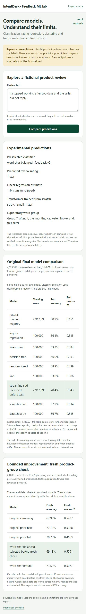

# Bounded feedback-model improvement

The original feedback release is complete and preserved in [Milestone 10](../reports/Milestone_10.md). Its development-selected streaming classifier scored 70.37% accuracy and 0.5427 macro-F1 on the original 20,000-review final test. Both scratch transformers completed 20 epochs, but their selected checkpoints were epochs 8 and 4. Fit loss continued to fall while development loss rose. Further neural epochs were not justified by that evidence.

The user requested improvements toward 90% accuracy. This follow-up keeps the same five subjective rating labels and does not guarantee that target. It tests one bounded lexical alternative rather than continuing indefinitely.

## Frozen candidate comparison

- Original full-fit streaming classifier, unchanged.
- Original probabilities multiplied by the natural fit-class priors to powers 0.5 and 1.0, then normalized. This is a prior-shift hypothesis, not established calibration.
- Word/character hashed features with inverse-frequency class weights.
- The same word/character features with natural class weights.

The two new classifiers receive the same 2,912,393 eligible fit reviews in one streaming pass. Word/bigram and character-within-word 3–5-gram views each use 262,144 hashed float32 dimensions. Their normalized vectors are concatenated with equal scaling. SGD uses log loss, averaging and alpha 0.000001. The two weighting variants share each computed feature batch. This changes features, shrinkage and weighting relative to the old candidate, so it does not isolate one variable's causal effect.

The existing 10,000-review development sample selects maximum macro-F1, with accuracy and then alphabetical tie-breaking. The original classifier is retained unless the best candidate improves development macro-F1 by at least 0.005. A higher majority-class accuracy with worse macro-F1 cannot displace it. This development sample is already exposed from earlier work; the fresh check below provides a separate evaluation.

## Fresh evaluation groups

The new check reserves **20,000 reviews from 16,629 products**. Every one of the **11,590 products** present in the original final sample is excluded entirely, including its unselected reviews. Product/fingerprint partition rules and existing rating-declaration cleanup remain unchanged. Selection follows eligible text-hash order without rating balancing; no fresh-check text is used for training or selection.

This exclusion shifts the population toward less-reviewed products. The old classifier and all fixed candidates are compared on the same fresh sample. Do not compare its percentage directly with the old final percentage as an improvement estimate. Product disjointness does not guarantee user, temporal or semantic-near-duplicate independence.

Source/data/configuration, baseline metadata, consumed baseline marker, checkpoints and the new check are bound by hashes. The original artifact pointer and experiment markers remain unchanged. Final exposure is marked before predictions; completed unchanged evaluation is reused, while interrupted or changed checks refuse re-exposure.

## Local execution and current state

Run from the repository root after completing the original feedback release:

```powershell
rtk proxy uv run --no-sync python scripts/run_feedback_v2_job.py
```

Progress, errors and explicit completion/failure status are saved under `local/feedback_v2_job/`. The same OS training lock prevents duplicate jobs. Checkpoints resume only with matching identities. There are no paid APIs, cloud GPUs or AI monitoring calls in the training script.

**Current state:** fitting, development selection, fresh final checking and app integration are complete. [Milestone 11](../reports/Milestone_11.md) preserves every actual outcome. The balanced word/character model was preselected at development macro-F1 0.5500 versus original 0.5424, passing the 0.005 guard. Fresh accuracy/macro-F1 were 69.13%/0.5591 versus original 67.955%/0.5487 on the same fresh sample. The natural-weight model reached 73.59% accuracy but lower macro-F1 0.5077 and was not substituted after test. 90% was not achieved. Both final tests are consumed; no further neural epochs are justified by the recorded development curves.

Raw reviews, reserved check text, weights, databases and machine logs stay excluded from GitHub. Only qualified aggregate results belong in publication. A stronger score on this task does not establish support-intent accuracy, customer savings or production reliability.

The checked `feedback_release.py` wrapper uses the selected V2 classifier while preserving the original regression, scratch-transformer and clustering methods. The actual browser/API smoke returned one star from the active V2 classifier and scratch model, plus an unclipped 1.14-star regression estimate for a fictional stopped-working review. All original and fresh comparison rows were visible. This single example verifies implementation, not model accuracy.


