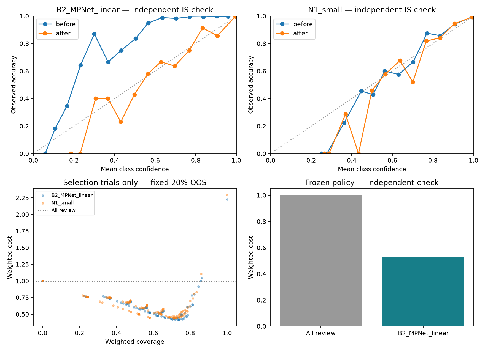

# Milestone 3: audit fixes, calibration and independently checked routing

Completed 10 October 2026, entirely on this PC. **48 tests pass. Final test not evaluated. Automatic routing is disabled because the proposed policy failed its independent check.**

Policy run: `policy_20261010T043806079244Z`. Parent frozen models: `neural_20261009T204150600532Z`.

## Verified weaknesses and changes

| Finding | Fix or evidence-based response |
| --- | --- |
| Missing embedding array plus completed progress could create a zero-filled “completed” cache | Reject missing files with nonzero progress; verify completed array checksums, shape, dtype, finite values and unit norms; never regenerate checksums to bless a changed completed cache. New partial checkpoints include prefix checksums. |
| Neural inference called `.strip()` before validating input types and silently truncated long requests | Reuse shared input validation; legacy neural predictions report token counts/truncation. The new router sends requests exceeding the evaluated 128-token limit to review without classifying a truncated fragment. |
| The larger head had weaker development results and was the only neural demo path | Keep it as an experiment; freeze B2/N1 as routing candidates. Select using a documented policy-selection partition. The new router uses B2 and loads its encoder once per reusable instance. |
| The legacy linear artifact had no recorded model hash | Reproduce its recorded tuning metrics, then seal its checksum before calibration/validation outcomes are measured. Future training records a linear checksum and checks reload parity. Frozen routing verifies model, encoder, prototype and policy-metadata hashes. These are local integrity checks, not third-party authenticity guarantees. |
| Raw confidence was not evaluated for reliability or unsupported requests | Fit one positive temperature per frozen candidate on calibration data only; add train-only intent prototypes, threshold selection, an independent check, uncertainty bounds and a fail-closed review fallback. |
| A development label appears incorrect; other mistakes depend on missing dialogue context | Preserve original labels and scores. Record assistant review and a separately labeled one-row sensitivity analysis; human review remains pending. |

See [the development error review](Development_Error_Review.md) and [supplementary sensitivity](development_label_sensitivity.json). The flagged weather/card-replacement row changes B2 accuracy from 97.6604% to 97.7258% only in the supplementary 1,495-row analysis. It does not change the model ranking. The original 1,496-row result remains primary. No dataset labels, weights or original run artifacts were changed.

## Frozen experimental design

1. Keep model weights fixed. Fit temperatures using 1,496 reserved calibration requests.
2. Split the audited official-validation allocation once, stratified with a fixed seed: **620 selection rows** (600 IS + 20 OOS) and **2,476 independent-check rows** (2,396 IS + 80 OOS). All groups are unique and disjoint. The test file is unopened.
3. Derive one normalized embedding prototype per intent from fit rows only. This cosine-support heuristic is a separate condition, not an OOS probability.
4. Search the predeclared 252 model/confidence/cosine configurations using selection rows only. Use a fixed scenario of 20% OOS, wrong-route cost 10, human-review cost 1; minimize weighted cost among configurations meeting point constraints.
5. Save the selected policy and temperatures before exposing check outcomes. Check once. Re-running `build-policy` reuses the frozen result; it does not search again. A crash after check exposure also blocks reselection.

The small selection OOS sample is a limitation. Its optimistic 1/20 acceptance rate did not generalize to the independent 9/80 result. That is why the independent check and fail-closed behavior are necessary.

## Calibration result on 2,396 independent in-scope requests

| Candidate | Temperature | Accuracy, unchanged | Log loss before → after | Brier before → after | ECE before → after |
| --- | ---: | ---: | --- | --- | --- |
| B2 MPNet + linear | 0.4913 | 96.29% | 0.2844 → **0.1408** | 0.0907 → **0.0537** | 0.1397 → **0.0068** |
| N1 small neural head | 0.9517 | 95.99% | 0.1703 → 0.1721 | 0.0601 → 0.0602 | 0.00754 → 0.00758 |

Temperature scaling materially helped B2 and slightly worsened N1 on the check partition. Do not describe calibration as a guaranteed improvement. ECE uses 15 equal-width bins; low-count bins are noisy, so read the counts and other metrics too. Known-class calibration does not establish that an unknown request belongs to a supported intent.

Method reference: Guo et al., [*On Calibration of Modern Neural Networks*, ICML 2017](https://proceedings.mlr.press/v70/guo17a.html), especially the positive scalar temperature and NLL objective in section 4.2 of the [paper](https://proceedings.mlr.press/v70/guo17a/guo17a.pdf). This is our application of the method, not a reproduction of the published benchmark experiments.

## Proposed policy: failed independent check

Selected using selection rows: **B2**, calibrated confidence ≥ **0.90**, predicted-intent cosine support ≥ **0.30**.

| Independent-check observation | Result |
| --- | ---: |
| Known requests accepted by proposed thresholds | 2,181 / 2,396 |
| Wrong known-label routes among accepted known requests | 16 / 2,181 |
| Unsupported requests incorrectly accepted | **9 / 80 = 11.25%** |
| Scenario-weighted proposed coverage, 20% OOS | 75.07% |
| Scenario-weighted proposed selective error | 3.71% |
| Scenario-weighted proposed cost | 0.5277 versus all-review 1.0 |
| Conservative OOS acceptance upper bound | **21.09%**, exceeding the 5% target |
| Conservative weighted selective-error upper bound | **7.11%**, exceeding the 5% target |
| Conservative coverage lower bound | 71.76%, exceeding the 40% minimum |

The point cost estimate does not override the failed rejection/error checks. The currently active recommendation behavior is **review every request**, with zero automatic routing coverage. The proposed 75.07% coverage is an offline measurement, not active behavior. No request changes an account, transfers a ticket or performs another external action.

The interval calculation combines three one-sided binomial-model bounds with Bonferroni adjustment. It is conditional on a fixed policy, the stated mixture and within-stratum independent/binomial sampling assumptions. The benchmark is class-stratified and crowdsourced, so these are model-based uncertainty estimates, not distribution-free guarantees for real traffic. Cost also has a separate stratified bootstrap interval, [0.4068, 0.6599]; this is an illustrative cost model, not measured business savings.



## Local verification and performance

- 48 tests passed: cache corruption/resume, inputs, actual neural learning/reload, calibration invariance, stratified disjoint allocation, scenario weighting, exact-bound edge cases, model tampering, overlong-request review, failed-gate review and blocked reselection after check exposure.
- Current source hashes and policy-input hashes matched the frozen protocol. Completed fit/tune embeddings were reused without rewriting their manifest.
- Policy feature preparation: 4,592 requests, **106.2 seconds**, zero truncated rows; process peak working set **957,943,808 bytes**.
- Reusable `Router`: construction **0.75 seconds excluding Python imports**; four warmups then 40 sequential local requests, median **60.97 ms**, p95 **73.31 ms**. Peak working set **863,186,944 bytes**. These are CPU measurements excluding startup/imports, not an API/concurrency load test.
- All smoke requests returned review when the gate failed. Overlong requests were reviewed without classification; invalid inputs were rejected. [Smoke evidence](../docs/VERIFICATION.md).

Reproduce:

```powershell
cd 'D:\ml model forex\intentdesk'
uv run --locked --extra dev --extra neural pytest -q
uv run --locked --extra neural intentdesk build-policy
uv run --locked --extra neural intentdesk route "I lost my credit card"
uv run --locked --extra neural python learning/verify_router.py
```

## Next work

Keep the frozen failed result and review fallback. Build a separately scoped OOS detector using audited training negatives and genuinely fresh validation evidence. The consumed independent-check partition must not be reused to claim independent improvement. Existing `oos_development` rows need a leakage/quality audit before any training use. Do not use raw MS MARCO passages as automatically correct OOS labels: they can overlap supported concepts and have a different text distribution.

Collect a new reviewed evaluation set covering unsupported, ambiguous and multi-intent requests; distinguish near-scope and clearly unrelated requests. Predeclare the new experiment and acceptance rules before measuring it. Keep the final CLINC test reserved until the complete candidate/policy is frozen. A review-first API/UI can make the current classifier useful to a person while this research continues. The separate MS MARCO retrieval track still needs an index and relevance evaluation.

Read [the calibration/routing lesson](../learning/Calibration_and_Review.md) before changing thresholds or adding a detector. The project now demonstrates calibration, OOS evaluation, uncertainty, data-quality triage and verified fallback behavior; it does not demonstrate production-ready autonomous routing.

For a public repository, shareable graphs in `reports/figures/` and [the exported evidence snapshot](portfolio_evidence.json) preserve the key results even though detailed `reports/runs/` folders are ignored. `learning/export_portfolio.py` exports these fixed milestone snapshots without raw data or model weights. These files are eligible for source control; no repository has been published.
