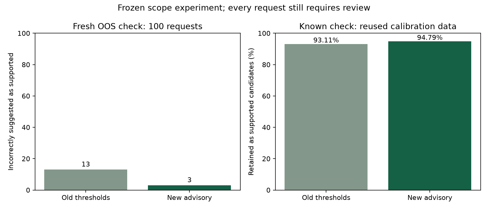

# Milestone 6: separately trained scope advisory

Completed 10 October 2026. This release adds an advisory detector for unsupported requests. It leaves the original classifier, failed routing gate and consumed final evaluation unchanged. **Every request still requires human review; no automatic action occurs.**

Verification: **87 Python tests and 2 JavaScript tests pass**; wheel contents, the running model API, reanalysis/history and explicit decision saving were checked. See [scope verification](../docs/VERIFICATION.md) for exact evidence scope and the remaining search-timeout/desktop-capture limitations.

## Data and method

The unused original 100 OOS training examples passed provenance and fingerprint-overlap checks. The pinned CLINC `data_oos_plus.json` contains 250 OOS training rows; 99 match existing fingerprints and are excluded from the new allocation. The remaining **151 previously unused OOS examples** are split deterministically into 51 for threshold selection and 100 for checking. They retain public crowd-authored labels; no new independent semantic adjudication is claimed.

The original fit set is split into **9,524 reference examples** and **2,393 known examples for the binary detector**. A query's own vector is excluded from the nearest-neighbor reference during detector training. Six features combine nearest-reference cosine, top-five mean cosine, maximum prototype cosine, known-class maximum probability, top-two margin and normalized entropy. StandardScaler and balanced logistic regression (`C=1`) fit on the detector training allocation only. The 109M-parameter encoder and original intent classifier remain frozen.

Known threshold-selection data reuse the original tune set. The known check contains **1,496 reused calibration examples**, previously used to fit the original temperature. Thus this is **not a fresh independent joint known/OOS test**. The 100 OOS check examples are new to this project's model/threshold selection, but come from the same public benchmark family.

Protocol, source/data/code/model hashes and thresholds were frozen before new check inference. The new check is now consumed. Completed commands reuse the bound result and refuse changed bindings or reports. Do not adjust this model or its thresholds using these check outcomes.

## Measured outcome

| Outcome on the same check examples | Old frozen thresholds | New frozen advisory |
| --- | ---: | ---: |
| Fresh OOS suggested as supported | 13/100 | 3/100 |
| Known retained as supported candidates (reused data) | 1393/1496 | 1418/1496 |

The new detector flags **97/100 fresh OOS examples** as likely unsupported, and incorrectly flags **78/1496 known requests**. There are 0 OOS examples in the middle uncertainty band in this run; its two selected thresholds coincide. A user can still choose `uncertain` manually.

The one-sided 95% exact upper bound on OOS false acceptance is **7.57%**. This exceeds the old 5% target even though the observed rate is 3%. Combined with the reused known check, that rules out treating this as authorization for automatic routing. The internal support score is uncalibrated and is not displayed as a probability of being supported.



## Application behavior

Likely unsupported requests display an explicit explanation, hide misleading known-label suggestions and prefill `oos` as an editable review suggestion. Saving remains a separate user action. Supported candidates retain their label shortlist and require confirmation. The original motorcycle example was a visible development smoke case, not part of the held-out benchmark; the running app now flags it as likely unsupported.

Older records preserve their original stored analysis. **Analyze again** creates a new queue entry; it never rewrites old analysis or decisions. The screen identifies earlier assessments and avoids presenting their old technical gate warning as a current processing error. Review feedback does not train a model.

## Reproduce and learn

```powershell
uv run --locked --extra neural intentdesk prepare-scope
uv run --locked --extra neural intentdesk train-scope
uv run --locked --extra neural intentdesk evaluate-scope
uv run --locked --extra neural --extra web intentdesk serve
```

Read [the scope lesson](../learning/Scope_Detection.md), [data audit](scope_data_audit.json) and [frozen evaluation](scope_evaluation.json). These results demonstrate a bounded improvement to a research advisory, not reliable rejection of every possible unsupported query. Fresh production-like data, independent review and a new untouched joint evaluation are required before proposing automatic routing. Buying a motorcycle and open-ended general assistance remain outside this application's capabilities.
