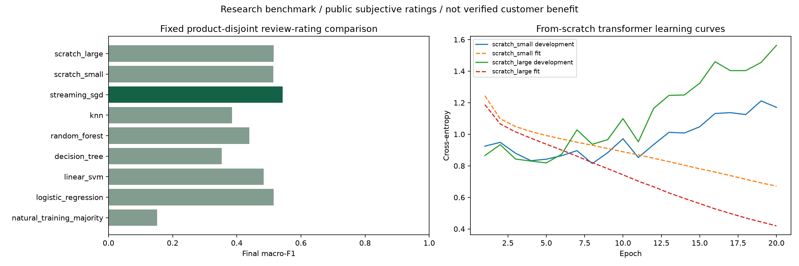
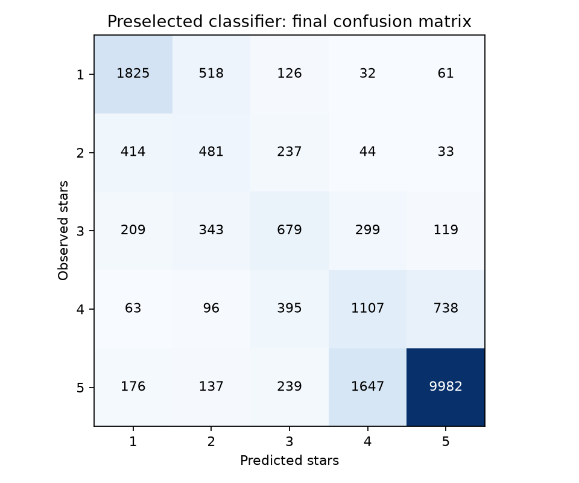
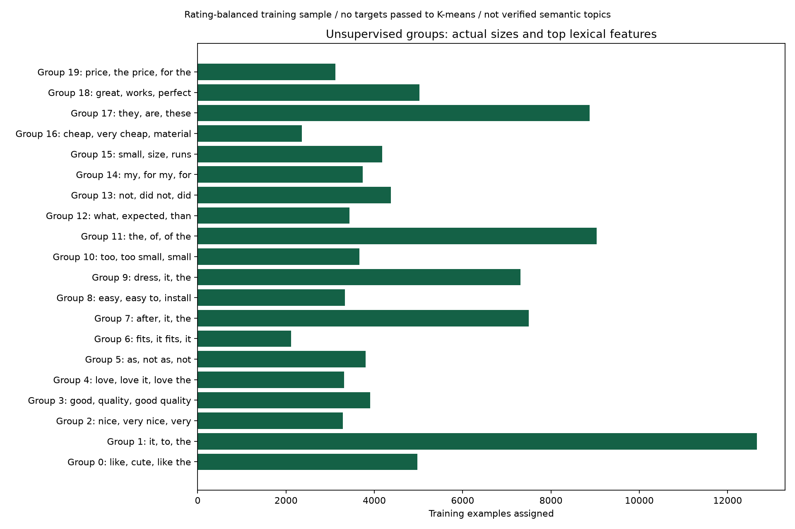

# Milestone 10: large-data supervised and unsupervised ML

Actual run: `feedback_lab_20261013T191518962929Z_20261013T230234996156Z`. Classifier selected before final exposure: **streaming_sgd**.

This is a separate public-review rating benchmark. It does not replace card-intent evaluation, establish customer savings or prove production reliability. All original experiments remain preserved.

## Data and allocations

Pinned source reviews: **4,629,544**, **1.98 GB** across complete Appliances and Amazon Fashion files.
Explicit star declarations were removed before fingerprinting. Product groups stay in one partition; conflicting-rating and cross-partition exact-text groups are excluded.

| Partition | Eligible unique reviews | Controlled comparison sample |
| --- | ---: | ---: |
| fit | 2,912,393 | 100,000 |
| development | 616,690 | 10,000 |
| test | 607,795 | 20,000 |

Controlled fit sampling is balanced at 20,000 per rating; development/test retain their selected natural rating distributions. Full-fit streaming uses every eligible fit review for one pass. Different data/feature/token budgets prevent an algorithm-only interpretation.

## Frozen final classification

| Candidate | Fit rows | Test accuracy | Test macro-F1 | Test prediction seconds |
| --- | ---: | ---: | ---: | ---: |
| natural_training_majority | 2,912,393 | 60.91% | 0.1514 | 0.02 |
| logistic_regression | 100,000 | 66.11% | 0.5149 | 0.08 |
| linear_svm | 100,000 | 63.77% | 0.4835 | 0.07 |
| decision_tree | 100,000 | 46.00% | 0.3529 | 0.07 |
| random_forest | 100,000 | 58.87% | 0.4389 | 5.13 |
| knn | 100,000 | 52.99% | 0.3857 | 10.41 |
| streaming_sgd **(preselected)** | 2,912,393 | 70.37% | 0.5427 | 1.52 |
| scratch_small | 100,000 | 67.92% | 0.5139 | 4.53 |
| scratch_large | 100,000 | 66.70% | 0.5147 | 22.59 |

Every fixed candidate was evaluated. Selection remains based on development macro-F1; no new selection uses these final scores. The product-disjoint test is now consumed.

Prediction timings are one sequential local CPU pass, with shared TF-IDF/SVD preparation excluded. Candidate-specific tokenization/loading may be included. They are not production latency or load benchmarks.

## Transformers trained from scratch

| Candidate | Trainable parameters | Fit rows | Completed epochs | Selected epoch | Fit examples truncated | Continuation seconds |
| --- | ---: | ---: | ---: | ---: | ---: | ---: |
| scratch_small | 1,318,021 | 100,000 | 20 | 8 | 17,510 | 2009.6 |
| scratch_large | 2,966,533 | 100,000 | 20 | 4 | 17,510 | 11403.4 |

All transformer components start randomly initialized: embeddings, positional embeddings, custom multi-head Q/K/V attention, feedforward layers, normalization and output classifier. No pretrained tokenizer or neural weights are loaded. The model sees CLS plus the first 63 tokens. This is supervised compact-transformer training, not foundation-model pretraining. Both models completed 20 total epochs; checkpoints were selected at epochs 8 and 4. Later fit loss fell while development loss rose, so extra epochs were not justified. Continuation times exclude the initial 6 small/3 large epochs. The original loss-selected checkpoint and last checkpoint were rescored on development during migration; unavailable earlier macro-F1 values are not fabricated. Larger does not imply better, and all measured outcomes are retained.

## Regression and unsupervised results

- linear_regression: MAE **0.9280 stars**, RMSE **1.1321**, R² **0.3855**. Predictions are not clipped.
- fit_mean_baseline: MAE **1.6547 stars**, RMSE **1.7689**, R² **-0.5002**. Predictions are not clipped.
- MiniBatchKMeans: test silhouette (first 1,000) **0.05682576075196266**; mean squared centroid distance **0.6483**.

The regression constant baseline uses the balanced 100,000-row fit mean, not an optimal full-natural-population mean. Linear regression assumes roughly equal spacing between ordinal star labels. SVD/K-means fitting receives no targets, but its training sample was selected using rating balance. Geometry scores are not verified topic accuracy.

## Limitations and delivery

Product disjointness does not ensure user-disjoint or temporal evaluation. Ratings are subjective and exact-text filtering changes the evaluation population. Cleanup cannot remove every label shortcut. Neural prefix truncation and reduced tree/KNN features lose information. The ASCII word tokenizer can lose non-English information; language filtering was not independently verified. Two product categories do not establish cross-domain or multilingual generalization. Scores from this rating task cannot be compared directly with the original 150-intent benchmark or synthetic card suites.

The standalone local lab is available at `/ml-lab` on port 8790. It shows the preselected classifier, numeric regression, a scratch-transformer output and exploratory cluster features. Outputs trigger no external actions, save no human review and do not retrain models. Model files and raw reviews remain excluded from GitHub.

Verification: **158 local Python tests and 2 JavaScript tests passed**, including a complete toy training/final-check path, analytic attention behavior, gradient/padding checks and standalone API boundaries. Full data/model results above came from the actual CPU run, not the toy tests. Model reload parity is checked during scratch training. Final browser and publication evidence is recorded in the verification guide.

[Protocol and commands](../docs/FEEDBACK_ML_LAB.md) · [Learning exercises](../learning/ML_Lab_Exercises.md) · [Unchanged aggregate snapshot](feedback_lab_v1/summary.json)

Preparation/training metadata's `test_exposed: false` records the pre-test state. The separate final marker and this report record subsequent consumption. Preserve both; later model changes need a new protocol and untouched evaluation.
