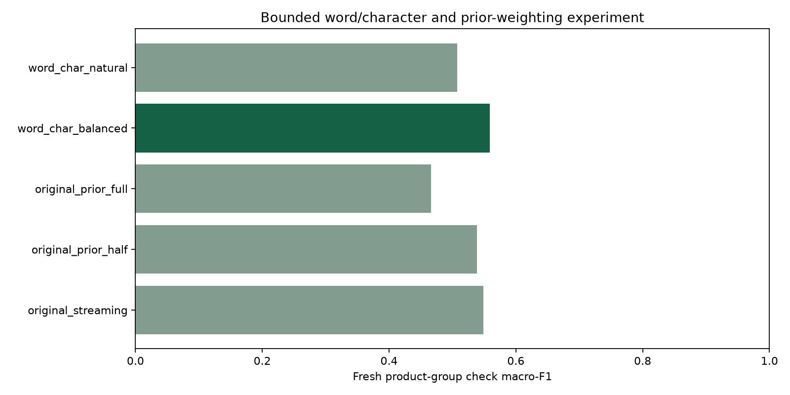

# Milestone 11: bounded feedback improvement and completed delivery

Actual run: `feedback_v2_20261014T014339447989Z`. Development selected **word_char_balanced** before the fresh final check. The five-rating task remains unchanged.

Both new word/character classifiers trained on **2,912,393** eligible fit reviews in one streaming pass, using fixed balanced/natural weightings. The original classifier and two predeclared prior adjustments were retained as controls.

The new 20,000-review check contains **16,629 previously untested products**, excluding all **11,590 products** used by the original test. This shifts toward less-reviewed products; compare candidates on this same fresh sample. Both final checks are now consumed.

| Candidate | Development accuracy | Development macro-F1 | Fresh accuracy | Fresh macro-F1 |
| --- | ---: | ---: | ---: | ---: |
| original_streaming | 70.99% | 0.5424 | 67.95% | 0.5487 |
| original_prior_half | 75.41% | 0.5219 | 72.12% | 0.5388 |
| original_prior_full | 74.30% | 0.4583 | 70.70% | 0.4663 |
| word_char_balanced **(preselected)** | 72.02% | 0.5500 | 69.13% | 0.5591 |
| word_char_natural | 76.62% | 0.4968 | 73.59% | 0.5077 |

The selected model gained **1.175 percentage points** of accuracy and **0.0104** macro-F1 against the original on this same check. No model was reselected using these final scores.

The natural-weight candidate reached higher accuracy but lower macro-F1. It was not substituted after testing: minority-rating performance remains part of the predeclared objective. **90% accuracy was not achieved.** No target labels/classes were changed, no final sample was cherry-picked, and no more neural epochs were added after their development curves showed overfitting.

The bounded two-model training and development comparison took **884.5 seconds** on this local CPU. This is one run, not a hardware or latency benchmark.

## Application and delivery

The local `/ml-lab` app composes the verified V2 classifier with the preserved regression, scratch-transformer and word-group outputs. Original and fresh test comparisons are separately labeled. Incompatible completed improvement artifacts fail explicitly; missing/incomplete improvement artifacts leave the original release available. Model/data/source hashes and final-report identity are checked. No external action or automatic retraining occurs.

The full local suite passes **162 Python tests and 2 JavaScript tests**; the updated browser script passes syntax checking. New release-composition tests preserve other method outputs, check data cleanup, require completed verified release evidence, and reject modified reports. Final actual HTTP/browser, packaging, publication and exact-commit CI evidence is recorded in the verification guide.

[Follow-up protocol](../docs/FEEDBACK_V2.md) · [Original 20-epoch experiment](Milestone_10.md) · [Actual aggregate snapshot](feedback_lab_v2/summary.json)

This is a completed local research portfolio implementation, not established production reliability or customer savings. Public rating labels are subjective; exact-text audits do not ensure semantic-near-duplicate, user or temporal independence. Real permissioned support-data and human-benefit validation remain separate future work.
