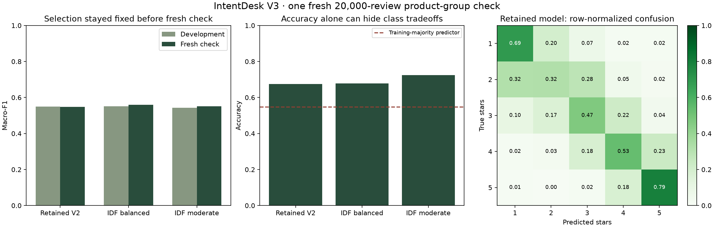

# Milestone 12 — bounded IDF experiment completed

2026-10-14. Run `feedback_v3_20261014T025622952640Z` completed three epochs and one reserved 20,000-review product-group evaluation. The job resumed its checkpoint under the OS training lock; a duplicate launch was refused. Frozen model sources, dependency lock, original experiments and earlier consumed evaluations were preserved.

## Decision fixed on development

| Candidate | Development accuracy | Development macro-F1 | Best epoch |
|---|---:|---:|---:|
| Previous word/character balanced V2 | 72.02% | 0.549993 | Previous fixed model |
| Fit-only IDF, balanced weights | 71.77% | 0.550706 | 2 |
| Fit-only IDF, moderate weights | 76.41% | 0.542832 | 3 |

The largest eligible macro-F1 gain was 0.000712, below the predeclared minimum 0.005. **Retain V2.** The moderate candidate's higher accuracy does not satisfy the selected macro-F1 objective. No application model replacement is justified under this protocol.

## Fresh-check results, all candidates on the same sample

| Candidate | Accuracy | Macro-F1 | Mean absolute star error |
|---|---:|---:|---:|
| Retained V2 | 67.55% | 0.548574 | 0.40635 |
| Balanced IDF | 67.82% | 0.559653 | 0.39835 |
| Moderate IDF | 72.375% | 0.551827 | 0.36135 |
| Fitting-majority predictor | 54.79% | 0.141585 | See machine report |

Balanced IDF did perform better than the control on this final sample. That observation is preserved but cannot be used to change the development-selected release after seeing the check. It is a hypothesis for an independently evaluated successor, not a reason to reset this consumed evaluation or lower the threshold retroactively.

The retained model made 6,490 errors, of which 5,313 were adjacent-star errors. The check excludes every product from either earlier consumed check, changing the population. Do not compare its 67.55% directly with the older 69.13% as though they used the same test set. No temporal, user-level or semantic-near-duplicate independence is established.

## What was trained and preserved

The source corpus contains 4,629,544 raw reviews across the existing pinned subsets. Each fitting pass uses 2,912,393 audited eligible reviews. A fit-only IDF pass precedes up to three SGD passes for each of two candidates. Full review text, decoded markup, word 1–2-grams and character 3–5-grams feed sparse 524,288-dimensional representations. These changes are bundled; this experiment does not isolate each change's causal contribution.

Metadata records best checkpoints, all epoch histories, source/data bindings and preselection. The final marker is completed and consumed. The retained release continues to compose V2 classification with the existing regression, transformer and clustering diagnostics. No 90% result, production reliability or customer benefit is established.

## Evidence and verification

- Full report: `reports/feedback_v3_runs/feedback_v3_20261014T025622952640Z/summary.json`.
- Protocol, metadata, history and marker: ignored local `artifacts/feedback_v3_20261014T025622952640Z/`.
- Job status: ignored local `local/feedback_v3_job/status.json` records completion.
- Software regression suite: **169 passed**; existing FastAPI test-client deprecation remains an advisory.
- Completed V3 artifact reload passed its binding checks; predictions on two synthetic smoke sentences matched the retained V2 control. This is a reload check, not an additional accuracy evaluation.
- `scripts/report_feedback_v3.py` renders the completed, hash-checked report without retraining or rerunning evaluation.
- [Public aggregate snapshot](feedback_lab_v3/summary.json) matches the completed report byte-for-byte (SHA256 `48abd330f2fa0b5da700326f191a57351d9500cbf2021b638c65b498ebe45a1d`). The check contains 17,632 products, excluding all 28,219 products used by either earlier check.
- The actual local HTTP/browser smoke verified retained V2, one-star classification and scratch outputs, unclipped 1.14-star regression and exploratory group 7 on a fictional stopped-working review. No human decision was saved. [Genuine browser evidence](../docs/assets/feedback-retained-v2.jpg).
- The rebuilt wheel matches all 47 Python/browser source files. All 16 protected original files remain byte-identical. Current software tests remain 169 Python and 2 JavaScript tests; source was not retuned after evaluation.
- [Learning notes](../docs/FEEDBACK_V3_LEARNING.md) explain the implemented mathematics and the distinction from Lilly's numerical forecasting.

This bounded attempt is stopped after its declared maximum. Source, learning documents and qualified aggregate evidence are delivered to the existing GitHub repository under the user's prior authorization. No raw reviews, weights, databases or credentials are published. Future modeling requires a new protocol and independent evidence; no automatic retraining or external action occurs in the app. Human/customer validation remains pending.
