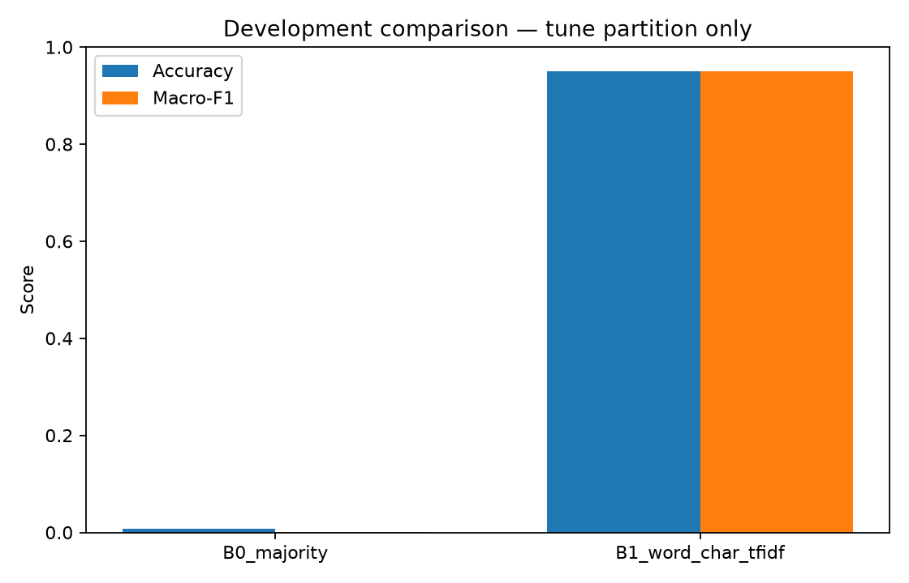
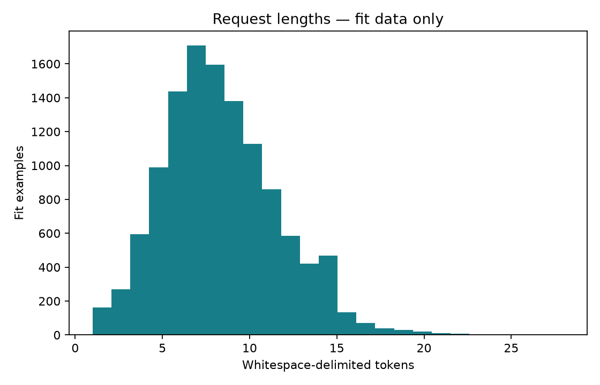
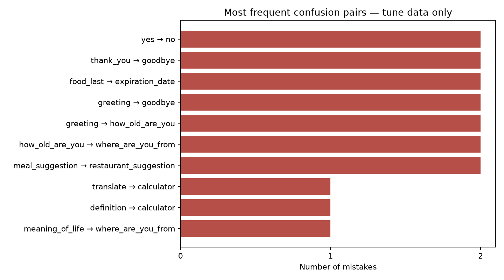

# First lexical baseline — development result

Run: `20261009T200903346981Z`. **Final test not evaluated.** These are tune-set results, not production results.

| Model | Accuracy | Macro-F1 | Log loss | Multiclass Brier |
| --- | ---: | ---: | ---: | ---: |
| Majority | 0.0067 | 0.0001 | 35.8027 | 1.9866 |
| Word + char TF-IDF / logistic regression | 0.9499 | 0.9494 | 0.3990 | 0.1305 |

Fit: 11,917; tune: 1,496; labels: 150. Training: 23.5 s.
One fixed configuration; no hyperparameter search or champion selection performed.
Raw classifier scores are uncalibrated. Automatic routing is disabled.
Neither embeddings nor a neural network nor generation have been implemented yet.

Review `development_errors.json`: 75 errors, **not yet manually reviewed**.
See `run.json` for data/source hashes, environment, model size, reload parity and measured latency.
The unused calibration, official validation and final-test partitions remain separate.
Public, crowdsourced, single-intent English data cannot establish performance on real customer traffic.
