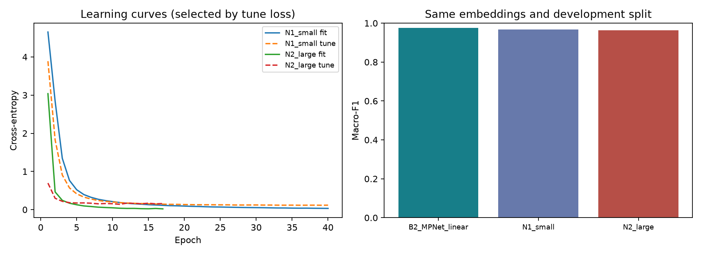

# Local neural experiment

Development only; final test not evaluated. Frozen pretrained MPNet; only the heads were trained here.

| Model | Accuracy | Macro-F1 | Log loss |
| --- | ---: | ---: | ---: |
| B2_MPNet_linear | 0.9766 | 0.9763 | 0.2341 |
| N1_small | 0.9679 | 0.9676 | 0.1149 |
| N2_large | 0.9639 | 0.9634 | 0.1392 |

N1: 768 → 128 → 150. N2: 768 → 1024 → 512 → 150. Same optimizer and epoch budget; widths/depth change together. One seed, fixed configurations; this is not evidence of statistical superiority or production quality. Calibration, OOS handling and official validation are still pending. The larger head is available for inspection, not automatically promoted.

See run.json for hashes, sizes and timing; history.json for every epoch; *_errors.json for unreviewed mistakes.
