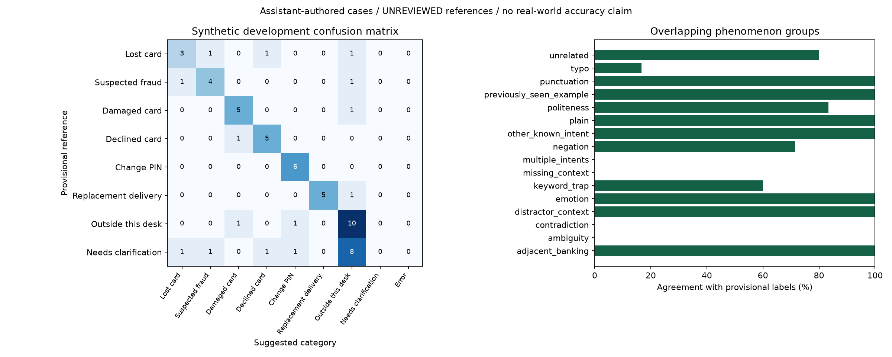

# Synthetic development robustness check

Run: `20261012T065219315139Z_0edb327c2b6b`

**Provisional, assistant-authored references. This is not independent test accuracy, human performance or evidence of customer savings.**

Cases: 60; agreement with provisional labels: 38/60 (63.3%).
Reviewer-declared reference labels supplied: 0. Independence and reviewer identity are not verified.

| Category | Reference count | Precision | Recall | F1 |
| --- | ---: | ---: | ---: | ---: |
| Lost card | 6 | 0.600 | 0.500 | 0.545 |
| Suspected fraud | 6 | 0.667 | 0.667 | 0.667 |
| Damaged card | 6 | 0.714 | 0.833 | 0.769 |
| Declined card | 6 | 0.714 | 0.833 | 0.769 |
| Change PIN | 6 | 0.750 | 1.000 | 0.857 |
| Replacement delivery | 6 | 1.000 | 0.833 | 0.909 |
| Outside this desk | 12 | 0.455 | 0.833 | 0.588 |
| Needs clarification | 12 | 0.000 | 0.000 | 0.000 |

Outside-desk examples suggested as one of the six supported categories: 2/12.
Unclear/multiple-issue examples suggested as a specific category: 4/12.
Runtime errors: 0. Unavailable scope: 0.
Successful sequential requests: 60; p50/p95 milliseconds: 136.86769997002557 / 183.46170003060251.
Model load and warm-up are recorded separately in JSON. Failed requests count as wrong; their elapsed time is retained in CSV and excluded from successful-request latency percentiles.

## Cases needing inspection

- `lost-02`: provisional `report_lost_card` → suggested `oos`; phenomena: typo.
- `lost-03`: provisional `report_lost_card` → suggested `card_declined`; phenomena: negation.
- `lost-04`: provisional `report_lost_card` → suggested `report_fraud`; phenomena: politeness.
- `fraud-02`: provisional `report_fraud` → suggested `oos`; phenomena: typo.
- `fraud-03`: provisional `report_fraud` → suggested `report_lost_card`; phenomena: negation.
- `damage-02`: provisional `damaged_card` → suggested `oos`; phenomena: typo.
- `decline-02`: provisional `card_declined` → suggested `damaged_card`; phenomena: typo.
- `delivery-02`: provisional `replacement_card_duration` → suggested `oos`; phenomena: typo.
- `outside-05`: provisional `oos` → suggested `damaged_card`; phenomena: keyword_trap, unrelated.
- `outside-07`: provisional `oos` → suggested `pin_change`; phenomena: keyword_trap, unrelated.
- `unclear-01`: provisional `uncertain` → suggested `oos`; phenomena: missing_context.
- `unclear-02`: provisional `uncertain` → suggested `oos`; phenomena: missing_context.
- `unclear-03`: provisional `uncertain` → suggested `oos`; phenomena: missing_context.
- `unclear-04`: provisional `uncertain` → suggested `pin_change`; phenomena: multiple_intents.
- `unclear-05`: provisional `uncertain` → suggested `oos`; phenomena: multiple_intents.
- `unclear-06`: provisional `uncertain` → suggested `card_declined`; phenomena: multiple_intents.
- `unclear-07`: provisional `uncertain` → suggested `report_lost_card`; phenomena: contradiction.
- `unclear-08`: provisional `uncertain` → suggested `oos`; phenomena: ambiguity.
- `unclear-09`: provisional `uncertain` → suggested `oos`; phenomena: multiple_intents.
- `unclear-10`: provisional `uncertain` → suggested `oos`; phenomena: missing_context.
- `unclear-11`: provisional `uncertain` → suggested `report_fraud`; phenomena: multiple_intents.
- `unclear-12`: provisional `uncertain` → suggested `oos`; phenomena: contradiction.

Review reference categories and ambiguity before interpreting disagreements. Then collect fresh, representative, independently adjudicated examples. Do not tune against consumed final/scope checks, fabricate human sessions, or treat this development suite as untouched evaluation.
